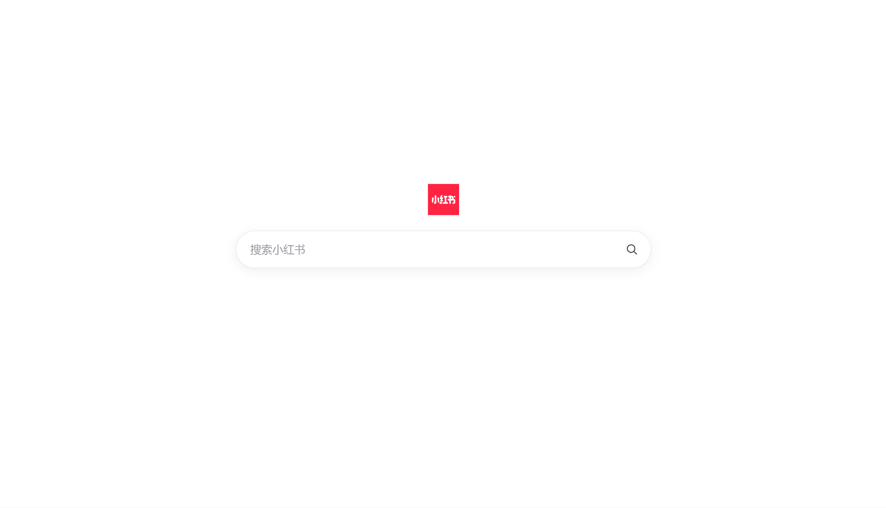

# Focus Search

Focus Search 是一个免费开源的 Chrome 扩展，提供统一检索入口、专注浏览和自定义快捷入口，帮助你减少推荐信息流干扰。

## 功能

- 极简新标签页
- 在 Google、小红书、知乎和 Bilibili 之间切换搜索
- 隐藏小红书、知乎和 Bilibili 首页的推荐信息流
- 保留搜索结果、文章阅读、视频播放和正常浏览器后退
- 添加、编辑和删除常用网站快捷入口
- 设置保存在浏览器本地，不上传搜索内容或浏览记录

## 截图

首页截图中包含自定义快捷入口示例。

## 支持的平台

| 平台 | 搜索 | 首页专注模式 |
| --- | --- | --- |
| Google | 支持 | 不处理 |
| 小红书 | 支持 | 支持 |
| 知乎 | 支持 | 支持 |
| Bilibili | 支持 | 支持 |

## 安装

1. 下载或克隆本项目。
2. 打开 Chrome，访问 `chrome://extensions/`。
3. 开启右上角的“开发者模式”。
4. 点击“加载已解压的扩展程序”。
5. 选择包含 `manifest.json` 的项目文件夹。
6. 打开新标签页即可使用。

本项目无需安装依赖或执行构建命令，源码目录可以直接加载。修改代码后，在扩展管理页点击刷新按钮即可更新。

## 使用

- 点击搜索框左侧的图标，选择搜索平台。
- 输入关键词后按 Enter，或点击搜索按钮。
- 点击搜索框下方的 `+` 添加快捷入口。网址必须以 `http://` 或 `https://` 开头。
- 右键快捷入口可以编辑或删除。
- 点击浏览器工具栏中的 Focus Search 图标，可分别开关小红书、知乎和 Bilibili 的专注模式。

## 隐私

Focus Search 不包含账号系统、后台服务、广告或统计代码，不读取 Cookie、密码、访问令牌或浏览历史。搜索请求直接发送到对应平台的官方网页；快捷入口和设置仅保存在浏览器本地。

## 已知限制

- 小红书、知乎和 Bilibili 页面结构变化后，专注模式可能需要更新。
- 网站 favicon 加载失败时，会显示默认图标。
- 部分平台功能可能受登录状态或平台自身规则限制。

## 免责声明与商标说明

Focus Search 是一个独立开发、免费开源的非商业浏览器扩展项目。本项目与 Google、小红书、Bilibili、知乎等平台不存在官方合作、赞助或隶属关系。

项目中涉及的第三方平台名称、Logo 及其他品牌标识均归相应权利人所有，仅用于帮助用户识别对应的信息检索平台，不属于本项目 MIT License 的授权范围。本项目不主张拥有上述第三方品牌标识的权利。

如相关权利人对素材使用存在疑问或提出合理要求，欢迎通过 GitHub Issues 联系项目维护者，我们将及时核查并采取适当措施。

## 开源许可

原创代码使用 [MIT License](LICENSE) 发布。第三方平台名称、Logo、favicon 和其他品牌素材不包含在 MIT License 授权范围内。

## 反馈与贡献

欢迎通过 GitHub Issues 反馈问题或提交改进建议。反馈时请不要上传 Cookie、Token、账号信息或其他私人数据。

本项目使用 Codex 辅助开发和整理文档。
